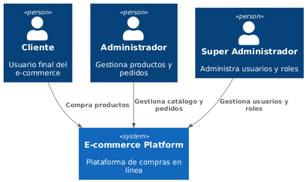
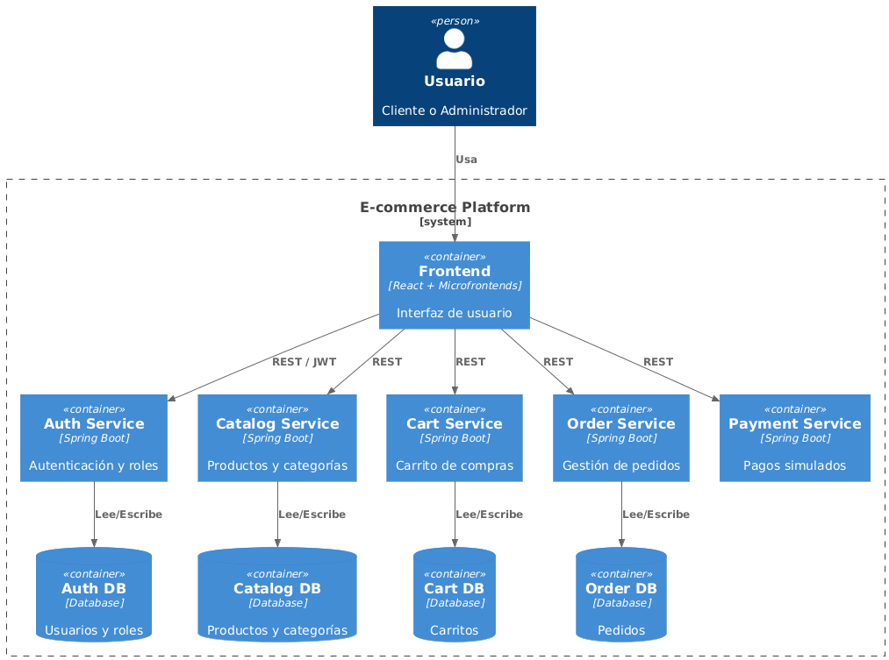

# Arquitectura del Sistema – E-commerce

## 📌 Introducción

Este documento describe la **arquitectura de alto nivel** del proyecto **E-commerce**, diseñada como parte del MVP con el objetivo de demostrar buenas prácticas de diseño de software, separación de responsabilidades y escalabilidad.

La arquitectura se apoya en:

* **Microservicios** para el backend
* **Microfrontends** para el frontend
* **Arquitectura Hexagonal** en cada microservicio
* Comunicación mediante **APIs REST** documentadas con OpenAPI

Para su representación se utiliza el **modelo C4**, enfocado en facilitar la comprensión del sistema a diferentes niveles.

---

## 🧩 Modelo C4

En esta fase del proyecto se cubren los dos primeros niveles del modelo C4:

* **Context Diagram (Nivel 1)**
* **Container Diagram (Nivel 2)**

Los niveles de Component y Code se abordarán en etapas posteriores del desarrollo.

---

## 🌍 Diagrama C4 – Context

### Propósito

El diagrama de contexto muestra el sistema como una **caja negra**, identificando:

* Los tipos de usuarios que interactúan con la plataforma
* El alcance funcional general del sistema
* La ausencia de dependencias externas reales (pagos simulados)

### Actores

* **Cliente**: Usuario final que navega el catálogo, gestiona su carrito y realiza pedidos.
* **Administrador**: Usuario encargado de la gestión de productos, categorías y pedidos.
* **Super Administrador**: Usuario con control total del sistema, incluyendo la gestión de usuarios y roles.

### Sistema

* **E-commerce Platform**: Plataforma central que provee funcionalidades de compra en línea y administración.

### Diagrama

---

## 🧱 Diagrama C4 – Container

### Propósito

El diagrama de contenedores describe cómo el sistema se divide internamente en:

* Aplicaciones frontend
* Microservicios backend
* Bases de datos
* Mecanismos de comunicación

Este nivel permite entender **responsabilidades técnicas** sin entrar aún en detalles de implementación.

---

### Frontend

El frontend está basado en una arquitectura de **microfrontends**, orquestados por una aplicación contenedora (Shell).

Microfrontends incluidos:

* **Auth App**: Autenticación y gestión de sesión
* **Catalog App**: Visualización de productos y categorías
* **Cart App**: Gestión del carrito de compras
* **Orders App**: Checkout, pago simulado y consulta de pedidos
* **Admin App**: Gestión administrativa del sistema

#### Topología de Module Federation

Cada microfrontend es una aplicación Vite independiente que publica un `remoteEntry.js`. El Shell los carga
en runtime y todos comparten `react`, `react-dom` y `react-router-dom`.

| App | Puerto local | Expone | Consume |
|---|---|---|---|
| Shell | 5000 | `TopNavBar`, `Footer`, `eventBus` | Los 5 remotos |
| Auth App | 5001 | `AuthApp`, `authService`, `useAuth` | — |
| Catalog App | 5002 | `CatalogApp` | `shellApp`, `authApp` |
| Cart App | 5003 | `CartApp` | `authApp` |
| Orders App | 5004 | `OrdersApp` | — |
| Admin App | 5005 | `AdminApp` | — |

La comunicación **entre microfrontends** usa `CustomEvent` sobre `window` (`ecommerce:cart-add-item`,
`ecommerce:auth-session-change`). Es un mecanismo del navegador, distinto de la comunicación entre
microservicios, que en el MVP sigue siendo síncrona.

El detalle de cada app está en su propio `README.md`.

---

### Backend

El backend está compuesto por **microservicios independientes**, cada uno implementando arquitectura hexagonal y siendo dueño de su propio dominio y base de datos.

Microservicios:

* **Auth/User Service**
  Gestión de usuarios, roles y autenticación basada en JWT.

* **Catalog Service**
  Gestión de productos y categorías.

* **Cart Service**
  Manejo del carrito de compras por usuario.

* **Order Service**
  Creación y seguimiento de pedidos.

* **Payment Service (Mock)**
  Simulación del proceso de pago sin integración con pasarelas externas.

---

### Persistencia

Cada microservicio cuenta con su **propia base de datos**, garantizando:

* Bajo acoplamiento
* Independencia de despliegue
* Aislamiento de datos

---

### Comunicación

* El frontend se comunica con los microservicios mediante **APIs REST**.
* La autenticación se basa en **JWT**, emitidos por el Auth Service.
* La comunicación entre servicios es síncrona vía HTTP (en el MVP).

---

### Diagrama

---

## 🧠 Decisiones arquitectónicas clave

* Separación total entre frontend y backend
* Un microservicio por dominio de negocio
* Una base de datos por microservicio
* Pagos simulados para evitar dependencias externas
* Arquitectura orientada a escalabilidad y mantenibilidad
* Frontend desplegado en **Vercel**, un proyecto por microfrontend (ver sección siguiente)

---

## ☁️ Despliegue del frontend

* Cada microfrontend es un proyecto Vercel independiente sobre el mismo repositorio, con su propio
  *Root Directory*, para que cada remoto sirva su `remoteEntry.js` desde una URL estable.
* Las URLs de los remotos se inyectan con variables `VITE_*_REMOTE_URL` y quedan fijadas al compilar: los
  remotos se despliegan primero y el Shell al final.
* Cada remoto debe permitir CORS sobre `/assets/*`, porque el Shell los importa desde otro origen.
* El backend se despliega fuera de este repositorio y debe exponerse por HTTPS, con CORS para los dominios
  del frontend.

El plan de tareas está en la Fase 8 del [Roadmap](../../Roadmap-Microfrontends.md).

---

## 📍 Alcance actual

Esta documentación corresponde al **MVP** del proyecto. No se incluyen en esta fase:

* Integraciones con sistemas externos reales
* Comunicación asíncrona por eventos entre microservicios
* Diagramas de componentes o código

Estos aspectos se incorporarán en iteraciones posteriores.

---

